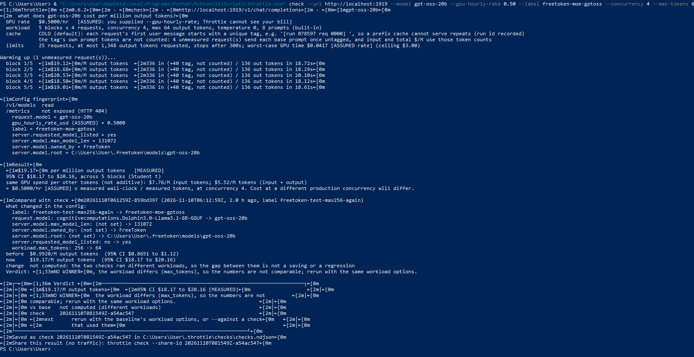

# FreeToken & Throttle: Edge-Native Inference Benchmarks on Consumer Hardware

This repository contains empirical benchmarks of **FreeToken** (an edge-native MoE serving engine from UC Berkeley/MIT) running on consumer hardware (NVIDIA RTX 5060), measured using **Throttle** (a rigorous statistical cost-per-token measurement tool).

## Hardware & Software Environment
*   **GPU:** NVIDIA GeForce RTX 5060 (8 GB VRAM)
*   **OS:** Windows 11 + WSL2 (Ubuntu)
*   **Tools:** FreeToken 0.2.0-beta, Throttle 0.6.2, Python 3.11

## Methodology
The benchmarks were run using `throttle check` against the FreeToken OpenAI-compatible API (`http://localhost:1919`). 
To ensure statistical rigor, Throttle was configured to measure run-to-run noise and to enforce the same workload for valid comparisons.

## Results

### 1. Dense Model Baseline: Dolphin 3.0 (Llama 3.1 8B, Q4_K_S)
This initial benchmark validated the Throttle measurement pipeline using a dense (non-MoE) model.
*   **Baseline (Concurrency 2, Max 64):** **$1.30 / M tokens** (95% CI: $1.17 - $1.42)
*   **Optimized (Concurrency 4, Max 64):** **$0.81 / M tokens** (95% CI: $0.76 - $0.86)
*   **Observation:** Increasing concurrency by 2x reduced the cost by **38%**, proving that FreeToken efficiently utilizes the GPU when it has more parallel requests.

### 2. MoE Model Stress Test: gpt-oss-20b (21B-A4B, MXFP4)
This is the real MoE test, using 128 KV cache pages to fit the weights (12.8 GiB) in the 8GB VRAM.
*   **Cost:** **$19.17 / M output tokens** (95% CI: $18.17 - $20.16)
*   **Latency:** ~18 seconds per block of 136 tokens
*   **Observation:** The cost exploded by **~15x** compared to the dense 8B model. The 8GB VRAM constraint forces heavy CPU-GPU offloading for the MoE experts, creating a severe memory bandwidth bottleneck. The FreeToken engine works, but the hardware is the limiting factor for MoE serving at this scale.

## Key Takeaways for Staff Engineers
1.  **Hardware constraints are real:** Running a 21B MoE model on an 8GB GPU is technically possible with FreeToken, but the cost per token becomes prohibitive ($19.17/M) due to CPU offloading overhead.
2.  **Measurement rigor is non-negotiable:** Throttle correctly detected a 12% run-to-run noise in the dense baseline, proving that without statistical tools, engineers mistake system noise for performance regressions.
3.  **Edge-native serving has limits:** Consumer hardware (8GB VRAM) can serve dense 8B models cost-effectively ($0.81/M), but MoE models of 20B+ require at least 16GB VRAM for viable cost-efficiency.

## Reproducibility
```bash
# Dense Baseline
throttle check --url http://localhost:1919 --model cognitivecomputations.Dolphin3.0-Llama3.1-8B-GGUF --gpu-hourly-rate 0.50 --label freetoken-dense --concurrency 4 --max-tokens 64

# MoE Test
throttle check --url http://localhost:1919 --model gpt-oss-20b --gpu-hourly-rate 0.50 --label freetoken-moe --concurrency 4 --max-tokens 64

```
## Raw Terminal Outputs

### MoE Stress Test (gpt-oss-20b, 21B-A4B)
*Shows the $19.17/M cost and the 18s latency caused by CPU-GPU offloading limits on an 8GB GPU.*



---
Authored by João Felipe de Souza (github.com/JohnScheuer)
